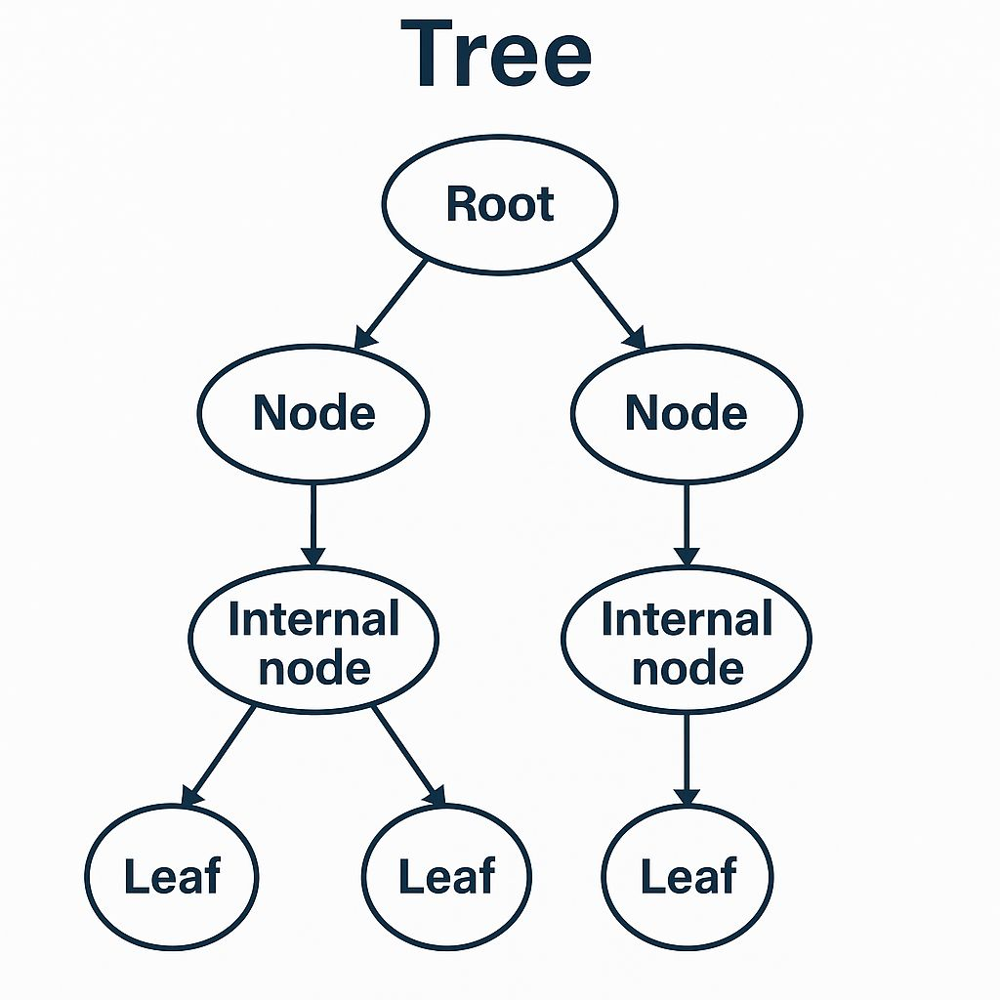
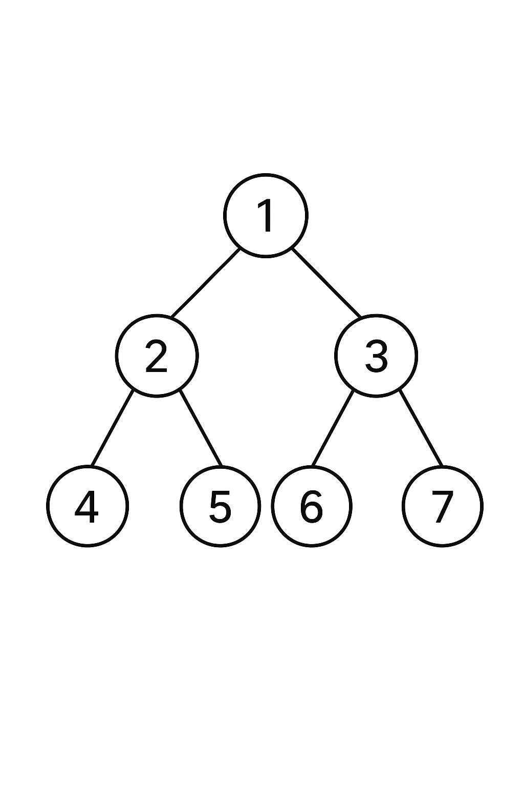

# AlgoLab – Algorithms & Data Structures Visualizer

**Explore. Understand. Visualize.**

AlgoLab is an interactive web application designed to help learners explore algorithms and understand data structures through visual demonstrations and hands-on interaction.

Instead of simply reading about algorithms, users can experiment with them, provide custom inputs, and observe how they work.

🌐 **Live Demo:** https://algolab-nadir.netlify.app/

---

## ✨ Features

### 🔎 Searching Algorithms
- Linear Search
- Binary Search

### ↕️ Sorting Algorithms
- Bubble Sort
- Selection Sort
- Insertion Sort
- Quick Sort

### 🧩 Data Structures
- Arrays
- Linked Lists
- Stacks
- Queues
- Circular Queues
- Trees

### 🚀 Additional Features
- Interactive operations and custom inputs.
- Visual demonstrations of algorithms and data structures.
- Clean and intuitive user interface.
- Responsive design for different screen sizes.
- Easy navigation between learning modules.

---

## 🖥️ Screenshots

### Main Menu


### Tree Visualization


### Binary Tree


---

## 🛠️ Technologies Used

- HTML5
- CSS3
- Vanilla JavaScript

---

## ⚙️ Run Locally

1. Clone the repository:

   ```bash
   git clone https://github.com/NadirAhmedMohamed/algolab.git
   ```

2. Navigate to the project directory:

   ```bash
   cd algolab
   ```

3. Open `index.html` in your browser.

No additional dependencies or installation steps are required.

---

## 🎯 Project Goal

AlgoLab aims to make learning algorithms and data structures more accessible and engaging through interactive visual experiences.

Whether you're learning the fundamentals or revising important concepts, AlgoLab provides a practical way to explore how things work.

**There's more to explore! Visit the live demo and discover the available algorithms and data structures.**

---

## 👨‍💻 Developer

**Nadir Ahmed**  
Frontend Developer | Software Engineer

- **Portfolio:** https://portfolio-nadirahmed.netlify.app/
- **GitHub:** https://github.com/NadirAhmedMohamed
- **LinkedIn:** https://www.linkedin.com/in/nadirahmed10/

---

*Built with passion for learning, problem-solving, and web development.*